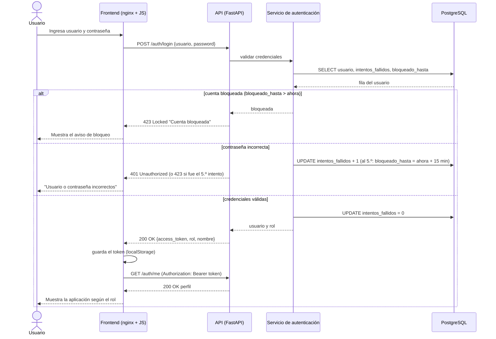
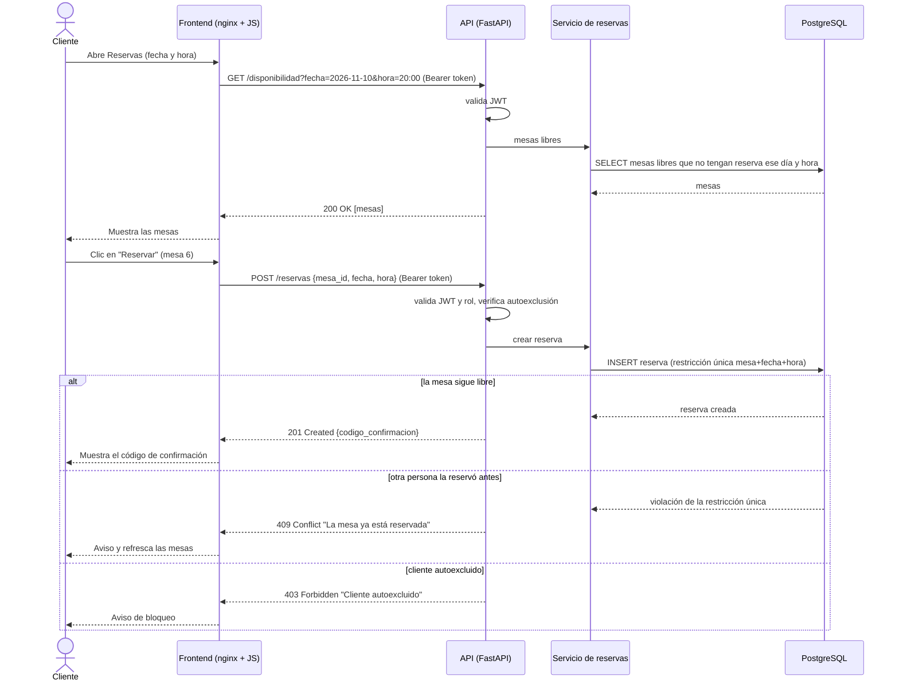
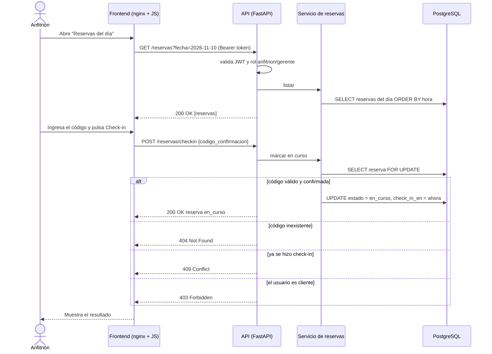
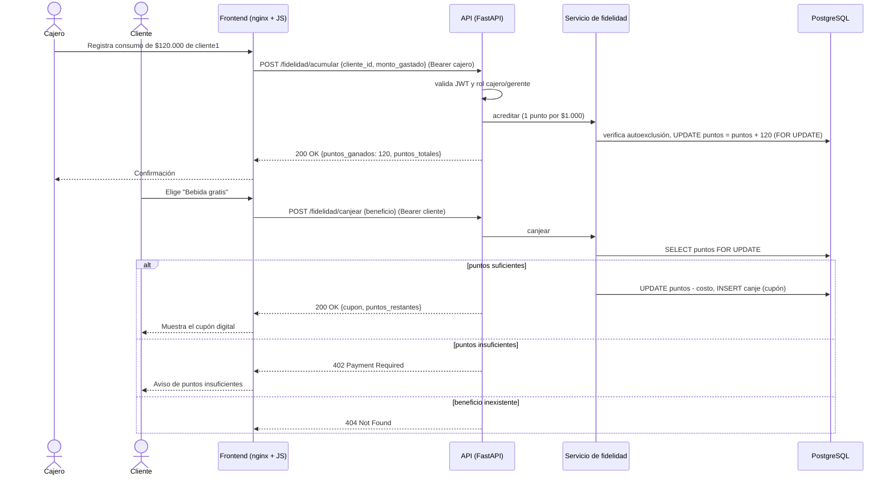
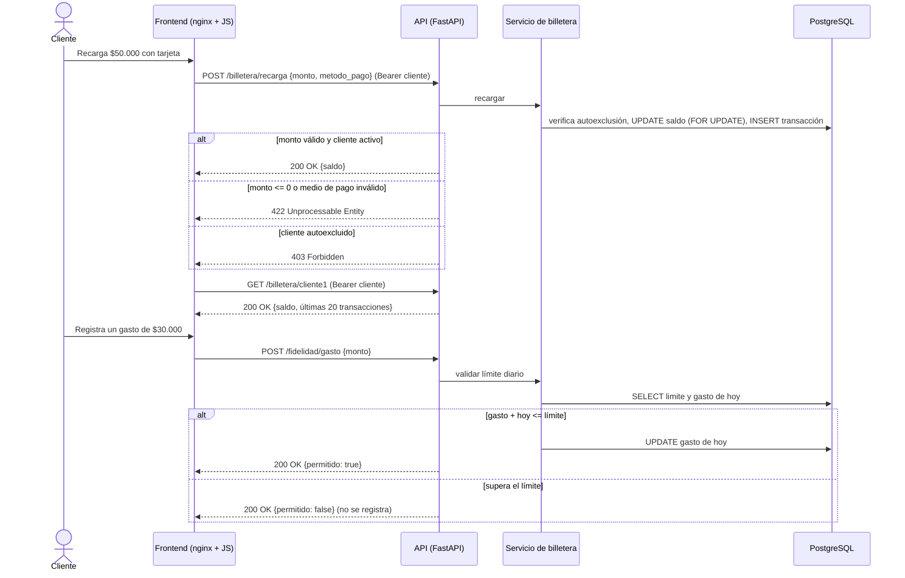
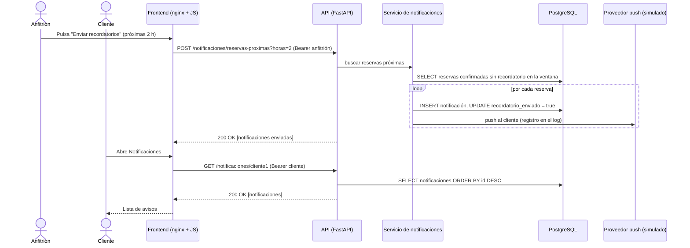

# Diagramas de secuencia UML

Participantes reales del sistema: el **actor** (cliente, anfitrión, cajero o gerente), el **Frontend** (nginx + JavaScript), la **API** (FastAPI, que valida el JWT y los roles), la **capa de servicio** (la lógica de cada router: reglas de negocio) y la **base de datos** (PostgreSQL). Cada mensaje hacia la API indica método HTTP y ruta. El proveedor push es un servicio externo simulado (ver deuda técnica).

GitHub renderiza los bloques `mermaid` directamente.

## 1. Inicio de sesión con JWT y bloqueo tras 5 intentos (REQ-NFUNC-003) — con camino alterno de error

## 2. Reserva de mesa (REQ-FUNC-001 y REQ-FUNC-002) — con camino alterno de conflicto

## 3. Check-in del anfitrión (REQ-FUNC-003)

## 4. Consumo en caja, acumulación y canje de puntos (REQ-FUNC-004 y REQ-FUNC-005) — con camino alterno de puntos insuficientes

## 5. Recarga de saldo y límite de gasto (REQ-FUNC-006, REQ-FUNC-011)

## 6. Notificaciones push (REQ-FUNC-009)

